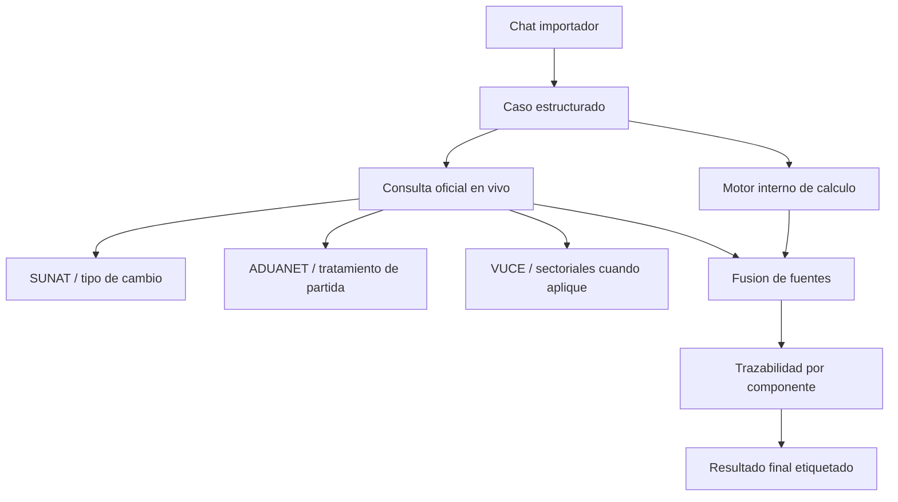

# Arquitectura de consulta oficial en vivo 2026

Este documento define como integrar consulta oficial en vivo dentro del cotizador sin romper el flujo conversacional ni mezclar importacion con otros modos como exportacion o regimenes especiales.

El objetivo no es convertir el chat en un formulario. El objetivo es:

1. mantener un flujo simple para el usuario
2. consultar en vivo lo que cambia en el tiempo
3. dejar trazabilidad clara de que parte vino de fuente oficial, cache, regla interna o estimacion

## Alcance

Aplica a:

- importacion definitiva
- courier
- postal / importa facil
- flujos de costo de importacion y precio sugerido

Quedan fuera por ahora:

- exportacion
- drawback
- reimportacion
- admision temporal
- perfeccionamiento activo o pasivo
- operativas DAM avanzadas posteriores al calculo comercial

## Principios estrictos

### 1. La fuente oficial manda cuando existe y responde

Si una fuente oficial o un conector oficial util responde bien, su resultado debe prevalecer sobre:

- datos desactualizados
- cache anterior
- heuristicas internas
- material doctrinario

### 2. El usuario no debe adivinar la fuente

Cada bloque del resultado debe decir de donde viene:

- `oficial_en_vivo`
- `cache_oficial`
- `regla_interna`
- `documento_usuario`
- `manual_usuario`
- `estimado`
- `referencial`

### 3. El chat no se vuelve mas pesado

La consulta oficial debe correr detras del flujo principal. El usuario no debe responder preguntas extra salvo cuando:

- falta un dato minimo
- hay conflicto entre documento y fuente oficial
- una regla exige decision manual
- la clasificacion sigue ambigua

### 4. Nada temporalmente sensible debe quedar solo doctrinario

Los PDFs o apuntes doctrinarios sirven para:

- cobertura funcional
- reglas de decision
- doctrina
- escenarios de prueba

No sirven como fuente final para:

- tasas aplicables
- reglas operativas cambiantes
- respuestas oficiales por subpartida
- restricciones actuales
- percepciones cambiantes
- tipo de cambio

### 5. Si la fuente oficial falla, el sistema no se cae

Debe degradar en este orden:

1. oficial en vivo
2. cache oficial reciente
3. regla interna versionada
4. referencial etiquetado

Nunca debe esconder que cayo a fallback.

## Estado actual del repo

Hoy ya existen piezas reutilizables:

- `server/agentes-navegacion/AgenteNavegadorSUNAT.js`
- `server/agentes-navegacion/AgenteNavegadorADUANET.js`
- `server/sunat-proxy.js`
- `server/conectores-gobierno.js`
- `server/nandina.js`
- `server/permisos.js`
- `server/valoracion.js`
- `server/agente.js`
- `server/auto-cotizar.js`
- `server/importacion-profile.js`

El problema no es la ausencia total de conectores. El problema es la falta de una politica unica de:

- prioridad de fuentes
- frescura del dato
- etiquetado del resultado
- criterio de fallback

## Matriz maestra de consulta

### 1. Clasificacion arancelaria

Dato: subpartida / HS / NANDINA

- Fuente principal: clasificacion interna + doctrina + arbitraje humano
- Fuente oficial viva: ADUANET / SUNAT para revisar tratamiento de la partida, no para adivinar la partida desde cero
- Modulos actuales:
  - `server/clasificador.js`
  - `server/nandina.js`
  - `server/agentes-navegacion/AgenteNavegadorADUANET.js`

Regla:

- la IA propone
- la doctrina arbitra
- ADUANET aporta el tratamiento de la subpartida elegida
- si hay conflicto fuerte, el sistema marca `requiere_revision`

No se debe vender como `oficial_en_vivo` la subpartida elegida por IA. Lo oficial puede ser el tratamiento de la partida ya definida.

### 2. Tipo de cambio

Dato: TC USD/PEN

- Fuente principal: SUNAT en vivo
- Fuente secundaria: cache oficial reciente
- Fuente terciaria: proveedor alterno etiquetado
- Modulos actuales:
  - `server/agentes-navegacion/AgenteNavegadorSUNAT.js`
  - `server/sunat-proxy.js`
  - `server/conectores-gobierno.js`

Regla:

- si el usuario informa TC manual, prima `manual_usuario`
- si no informa, se intenta `SUNAT en vivo`
- si no responde, se usa cache oficial reciente
- si tampoco hay, se cae a fallback etiquetado

### 3. Tributos base de importacion

Dato: ad valorem, IGV, ISC, IPM, base aduanera

- Fuente principal: tratamiento oficial de la subpartida consultada
- Fuente secundaria: reglas internas versionadas
- Modulos actuales:
  - `server/agentes-navegacion/AgenteNavegadorADUANET.js`
  - `server/conectores-gobierno.js`
  - `server/agente.js`

Regla:

- `valor en aduana = FOB + flete + seguro` sigue siendo regla interna
- tasas aplicables deben revisarse contra la partida
- si una tasa no pudo revisarse en vivo, debe salir como `regla_interna`

### 4. Percepcion

Dato: 10%, 5%, 3.5%, etc.

- Fuente principal: tratamiento arancelario consultado en vivo por subpartida, mas criterio del tipo de caso
- Modulos actuales:
  - `server/agente.js`
  - `server/auto-cotizar.js`

Regla:

- si el tratamiento oficial aporta el dato, debe prevalecer como base oficial
- si el caso requiere una condicion adicional, la salida debe ser `oficial_en_vivo + regla_interna`
- si el flujo detecta `bien_usado`, el motivo debe quedar visible
- solo debe quedar como `regla_interna` pura cuando la fuente viva no entregue dato suficiente

### 5. Convenios, restricciones y permisos

Dato: convenios por pais, restricciones, permisos, VUCE, entidades sectoriales

- Fuente principal: consulta oficial viva por subpartida y pais cuando exista
- Fuente secundaria: catalogo interno documentado
- Modulos actuales:
  - `server/conectores-gobierno.js`
  - `server/permisos.js`
  - agentes sectoriales de `server/agentes-navegacion`

Regla:

- si el tratamiento arancelario expone convenios, restricciones o criterios, el sistema debe intentar consultarlos en vivo
- si no existe API util o scraping robusto, el resultado debe salir como `regla_interna`, `cache_oficial` o `pendiente_revision`
- si hay duda, la salida correcta es `posible_restriccion`, no silencio

### 6. Tratamiento arancelario en vivo

Dato: gravamenes aplicables, convenios, restricciones, indicadores y resoluciones por subpartida

- Fuente principal: tratamiento arancelario por subpartida consultado en vivo en SUNAT/ADUANET
- Modulos actuales:
  - `server/agentes-navegacion/AgenteNavegadorADUANET.js`
  - `server/agentes-navegacion/AgenteNavegadorSUNAT.js`
  - `server/conectores-gobierno.js`

Regla:

- es la mejor fuente viva del sistema una vez fijada la subpartida
- no debe limitarse a extraer solo gravamenes
- debe intentar capturar convenios, restricciones, criterios y descripciones minimas cuando existan
- si el tratamiento oficial y la logica interna discrepan, debe ganar la fuente oficial y dejar alerta de conflicto

### 7. Valoracion aduanera

Dato: alertas de subvaluacion, incoherencia documental, costo improbable

- Fuente principal: motor interno de valoracion
- Fuente secundaria: doctrina y reglas de riesgo
- Modulos actuales:
  - `server/valoracion.js`
  - `server/cotizacion-insights.js`

Regla:

- esto no es consulta oficial en vivo
- debe mostrarse como analitica de riesgo interna

### 8. Flete y seguro

Dato: flete internacional, seguro, seguro de tabla

- Fuente principal: documento o dato manual del usuario
- Fuente secundaria: APIs logisticas reales
- Fuente terciaria: estimacion interna
- Modulos actuales:
  - `server/agente.js`
  - `server/auto-cotizar.js`
  - modulos de couriers y fletes

Regla:

- si el dato no viene de documento, API real o input manual, debe salir como `estimado` o `referencial`
- si se usa seguro de tabla, debe indicarse como tal

## Politica de prioridad de fuentes

Cada dato del resultado debe obedecer este orden:

1. `manual_usuario`
2. `documento_usuario`
3. `oficial_en_vivo`
4. `cache_oficial`
5. `regla_interna`
6. `estimado`
7. `referencial`

Excepciones:

- para `tipo de cambio`, `manual_usuario` puede prevalecer por criterio comercial
- para `subpartida`, la fuente oficial aporta tratamiento, no reemplaza la clasificacion automatica
- para `percepcion`, el tratamiento oficial puede aportar la base y la regla interna completar la condicion del caso

## Etiquetado obligatorio en la UI

La UI debe mostrar por bloque:

- `estado`
- `fuente`
- `fecha_consulta`
- `mensaje`

Ejemplo:

- `Ad Valorem: 6%`
  - `Fuente: oficial_en_vivo (ADUANET)`
  - `Consultado: 2026-03-24 10:42 America/Lima`
- `Percepcion: 5%`
  - `Fuente: regla_interna`
  - `Motivo: bien usado`
- `Flete: USD 120`
  - `Fuente: estimado`
  - `Motivo: no se informo costo real`

## Lo que no debe hacer el sistema

- no debe decir `SUNAT consultado en vivo` cuando uso una regla interna
- no debe ocultar que cayo a cache o fallback
- no debe frenar todo el flujo si una consulta en vivo falla
- no debe pedir preguntas sectoriales avanzadas demasiado pronto
- no debe mezclar importacion comun con exportacion o regimenes especiales

## Arquitectura recomendada

## Fases recomendadas

### Fase 1: normalizacion de fuente

Unificar por componente:

- `estado`
- `fuente`
- `fecha_consulta`
- `ttl`
- `mensaje`

### Fase 2: criterio unico de frescura

- tipo de cambio: 1 hora maximo
- tratamiento arancelario: 24 horas maximo si viene de cache oficial
- restricciones y permisos: 24 horas o menos segun entidad

Si el cache supera el TTL, debe rotularse como `stale`.

### Fase 3: integracion al resultado

El resultado final debe separar:

- consultado oficialmente en esta corrida
- calculado por regla interna
- estimado o referencial

### Fase 4: alertas de conflicto

Si documento, usuario y fuente oficial chocan, disparar:

- `conflicto_subpartida`
- `conflicto_tc`
- `conflicto_valor`
- `conflicto_restricciones`

## Recomendacion final

Si quieres un sistema confiable y trazable:

- usa el arbol conversacional para captar contexto
- usa doctrina para cubrir escenarios y reglas de decision
- usa fuentes oficiales en vivo para lo cambiante
- muestra siempre la procedencia real del dato

La mejor integracion no es hacer el chat mas largo. La mejor integracion es hacer el resultado mas confiable, trazable y honesto.
