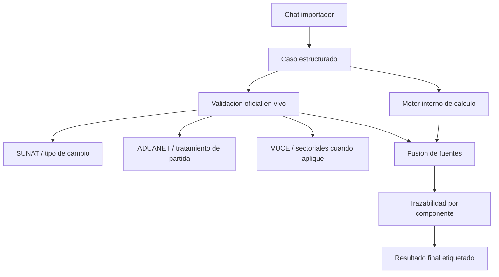

# Arquitectura De Validacion Oficial En Vivo 2026

Este documento define como debe integrarse la validacion oficial en vivo dentro
del cotizador, sin romper el flujo conversacional ni mezclar importacion con
otros modos como exportacion o regimenes especiales.

El objetivo no es convertir el chat en un formulario SUNAT. El objetivo es:

1. mantener un flujo de usuario simple;
2. validar en vivo todo lo que pueda cambiar en el tiempo;
3. dejar trazabilidad clara de que parte vino de fuente oficial, cache,
   regla interna o estimacion.

## Alcance

Este documento aplica solo a:

- importacion definitiva;
- courier;
- postal/importa facil;
- flujos de costo de importacion y precio sugerido.

Quedan fuera por ahora:

- exportacion;
- drawback;
- reimportacion;
- admision temporal;
- perfeccionamiento activo/pasivo;
- operativas DAM avanzadas posteriores al calculo comercial.

## Principios Estrictos

### 1. La fuente oficial manda cuando existe y responde

Si una fuente oficial o un conector oficial util responde bien, su resultado
debe prevalecer sobre:

- datos historicos;
- cache viejo;
- heuristicas internas;
- material doctrinario de clase.

### 2. El usuario no debe adivinar la fuente

Cada bloque del resultado debe decir de donde viene:

- `oficial_en_vivo`
- `cache_oficial`
- `regla_interna`
- `documento_usuario`
- `manual_usuario`
- `estimado`
- `referencial`

### 3. El chat no se vuelve mas pesado

La validacion oficial debe correr detras del flujo principal. El usuario no
debe responder preguntas extra salvo cuando:

- falta un dato minimo;
- hay conflicto entre documento y fuente oficial;
- una regla exige decision manual;
- la clasificacion sigue ambigua.

### 4. Nada temporalmente sensible debe quedar solo doctrinario

No se debe presentar como vigente algo que solo proviene de PDFs de clase si
esa materia cambia con el tiempo. Los PDFs sirven para:

- cobertura funcional;
- reglas de decision;
- doctrina;
- escenarios de prueba.

No sirven como fuente final para:

- tasas vigentes;
- reglas operativas cambiantes;
- confirmaciones oficiales por subpartida;
- restricciones actuales;
- percepciones si cambia criterio normativo;
- tipo de cambio.

### 5. Si la fuente oficial falla, el sistema no se cae

Debe degradar en este orden:

1. oficial en vivo;
2. cache oficial reciente;
3. regla interna versionada;
4. referencial etiquetado.

Nunca debe esconder que cayo a fallback.

## Estado Actual Del Repo

Hoy ya existen piezas reutilizables:

- [AgenteNavegadorSUNAT.js](/C:/Users/Billy/AppData/Local/Programs/Antigravity/cotizador/server/agentes-navegacion/AgenteNavegadorSUNAT.js)
- [AgenteNavegadorADUANET.js](/C:/Users/Billy/AppData/Local/Programs/Antigravity/cotizador/server/agentes-navegacion/AgenteNavegadorADUANET.js)
- [sunat-proxy.js](/C:/Users/Billy/AppData/Local/Programs/Antigravity/cotizador/server/sunat-proxy.js)
- [conectores-gobierno.js](/C:/Users/Billy/AppData/Local/Programs/Antigravity/cotizador/server/conectores-gobierno.js)
- [nandina.js](/C:/Users/Billy/AppData/Local/Programs/Antigravity/cotizador/server/nandina.js)
- [permisos.js](/C:/Users/Billy/AppData/Local/Programs/Antigravity/cotizador/server/permisos.js)
- [valoracion.js](/C:/Users/Billy/AppData/Local/Programs/Antigravity/cotizador/server/valoracion.js)
- [agente.js](/C:/Users/Billy/AppData/Local/Programs/Antigravity/cotizador/server/agente.js)
- [auto-cotizar.js](/C:/Users/Billy/AppData/Local/Programs/Antigravity/cotizador/server/auto-cotizar.js)
- [importacion-profile.js](/C:/Users/Billy/AppData/Local/Programs/Antigravity/cotizador/server/importacion-profile.js)

El problema actual no es la ausencia total de conectores. El problema es que
todavia no existe una politica unica de:

- prioridad de fuentes;
- frescura del dato;
- etiquetado del resultado;
- criterio de fallback.

## Matriz Maestra De Validacion

### 1. Clasificacion Arancelaria

**Dato:** subpartida/HS/NANDINA  
**Fuente principal:** clasificacion interna + doctrina + arbitraje humano  
**Fuente oficial viva:** ADUANET/SUNAT para validar tratamiento de la partida,
no para "adivinar" la partida desde cero  
**Modulo actual:** [clasificador.js](/C:/Users/Billy/AppData/Local/Programs/Antigravity/cotizador/server/clasificador.js),
[nandina.js](/C:/Users/Billy/AppData/Local/Programs/Antigravity/cotizador/server/nandina.js),
[AgenteNavegadorADUANET.js](/C:/Users/Billy/AppData/Local/Programs/Antigravity/cotizador/server/agentes-navegacion/AgenteNavegadorADUANET.js)

Regla estricta:

- la IA propone;
- la doctrina arbitra;
- ADUANET valida el tratamiento de la subpartida elegida;
- si hay conflicto fuerte, el sistema marca `requiere_revision`.

No se debe vender como `oficial_en_vivo` la subpartida elegida por IA. Lo que
si puede quedar como oficial es el tratamiento de la partida ya definida.

### 2. Tipo De Cambio

**Dato:** TC USD/PEN  
**Fuente principal:** SUNAT en vivo  
**Fuente secundaria:** cache oficial reciente  
**Fuente terciaria:** proveedor alterno etiquetado  
**Modulo actual:** [AgenteNavegadorSUNAT.js](/C:/Users/Billy/AppData/Local/Programs/Antigravity/cotizador/server/agentes-navegacion/AgenteNavegadorSUNAT.js),
[sunat-proxy.js](/C:/Users/Billy/AppData/Local/Programs/Antigravity/cotizador/server/sunat-proxy.js),
[conectores-gobierno.js](/C:/Users/Billy/AppData/Local/Programs/Antigravity/cotizador/server/conectores-gobierno.js)

Regla estricta:

- si el usuario informa TC manual, prima `manual_usuario`;
- si no informa, se intenta `SUNAT en vivo`;
- si no responde, se usa cache oficial reciente;
- si tampoco hay, se cae a fallback etiquetado.

### 3. Tributos Base De Importacion

**Dato:** ad valorem, IGV, ISC, IPM, base aduanera  
**Fuente principal:** tratamiento oficial de la subpartida consultada  
**Fuente secundaria:** reglas internas versionadas  
**Modulo actual:** [AgenteNavegadorADUANET.js](/C:/Users/Billy/AppData/Local/Programs/Antigravity/cotizador/server/agentes-navegacion/AgenteNavegadorADUANET.js),
[conectores-gobierno.js](/C:/Users/Billy/AppData/Local/Programs/Antigravity/cotizador/server/conectores-gobierno.js),
[agente.js](/C:/Users/Billy/AppData/Local/Programs/Antigravity/cotizador/server/agente.js)

Regla estricta:

- `valor en aduana = FOB + flete + seguro` sigue siendo regla interna;
- tasas aplicables deben validarse contra la partida;
- si una tasa no pudo validarse en vivo, debe salir como `regla_interna`.

### 4. Percepcion

**Dato:** 10%, 5%, 3.5%, etc.  
**Fuente principal:** tratamiento arancelario consultado en vivo por
subpartida, cuando la fuente lo exponga, mas criterio del tipo de caso  
**Fuente oficial viva:** pagina de tratamiento arancelario por subpartida y
criterio oficial asociado al caso  
**Modulo actual:** [agente.js](/C:/Users/Billy/AppData/Local/Programs/Antigravity/cotizador/server/agente.js),
[auto-cotizar.js](/C:/Users/Billy/AppData/Local/Programs/Antigravity/cotizador/server/auto-cotizar.js)

Regla estricta:

- si la pagina oficial de tratamiento por subpartida expone la percepcion o el
  tratamiento aplicable de forma consultable, debe prevalecer como
  `oficial_en_vivo`;
- si el caso requiere una condicion adicional que la pagina no resuelve sola
  (por ejemplo `bien_usado`, primera operacion o condicion del importador), la
  salida debe ser `mixta`: `oficial_en_vivo + regla_interna`;
- si el flujo detecta `bien_usado`, no basta con una regla muda: debe quedar
  visible el motivo por el cual se ajusto la percepcion;
- solo debe quedar como `regla_interna` pura cuando la fuente viva no entregue
  el dato suficiente.

### 5. Convenios, Restricciones Y Permisos

**Dato:** convenios por pais, restricciones, permisos, VUCE, entidades
sectoriales  
**Fuente principal:** consulta oficial viva por subpartida y pais de origen
cuando exista  
**Fuente secundaria:** catalogo interno/documentado  
**Modulo actual:** [conectores-gobierno.js](/C:/Users/Billy/AppData/Local/Programs/Antigravity/cotizador/server/conectores-gobierno.js),
[permisos.js](/C:/Users/Billy/AppData/Local/Programs/Antigravity/cotizador/server/permisos.js),
agentes sectoriales de `server/agentes-navegacion`

Regla estricta:

- si la pagina oficial de tratamiento arancelario expone pestañas como
  `Convenios`, `Restricciones`, `Descr. Minimas`, `Ind. Criterios` o
  `Resol. Clasif.`, el sistema debe intentar consultarlas en vivo cuando ya
  tiene la subpartida;
- para convenios, la validacion debe cruzar al menos:
  - subpartida;
  - pais de origen;
  - beneficio o preferencia aplicable;
- si la entidad no tiene API util o scraping robusto, el resultado debe salir
  como `regla_interna`, `cache_oficial` o `pendiente_validacion`, no como
  `oficial_en_vivo`;
- el sistema debe mostrar la entidad y el tipo de tramite;
- si hay duda, la salida correcta es `posible_restriccion`, no silencio.

### 6. Tratamiento Arancelario En Vivo

**Dato:** gravamenes vigentes, convenios, restricciones, indicadores y
resoluciones de clasificacion asociadas a la subpartida  
**Fuente principal:** tratamiento arancelario por subpartida consultado en vivo
en SUNAT/ADUANET  
**Modulo actual:** [AgenteNavegadorADUANET.js](/C:/Users/Billy/AppData/Local/Programs/Antigravity/cotizador/server/agentes-navegacion/AgenteNavegadorADUANET.js),
[AgenteNavegadorSUNAT.js](/C:/Users/Billy/AppData/Local/Programs/Antigravity/cotizador/server/agentes-navegacion/AgenteNavegadorSUNAT.js),
[conectores-gobierno.js](/C:/Users/Billy/AppData/Local/Programs/Antigravity/cotizador/server/conectores-gobierno.js)

Regla estricta:

- este bloque es la mejor fuente viva del sistema una vez fijada la subpartida;
- no debe limitarse a extraer `Ad Valorem`, `IGV` e `ISC`;
- debe intentar capturar tambien:
  - convenios por pais;
  - restricciones;
  - resoluciones o criterios;
  - descripciones minimas cuando existan;
- si el tratamiento oficial y la logica interna discrepan, debe ganar la fuente
  oficial y dejar alerta de conflicto.

### 7. Valoracion Aduanera

**Dato:** alertas de subvaluacion, incoherencia documental, costo improbable  
**Fuente principal:** motor interno de valoracion  
**Fuente secundaria:** doctrina y reglas de riesgo  
**Modulo actual:** [valoracion.js](/C:/Users/Billy/AppData/Local/Programs/Antigravity/cotizador/server/valoracion.js),
[cotizacion-insights.js](/C:/Users/Billy/AppData/Local/Programs/Antigravity/cotizador/server/cotizacion-insights.js)

Regla estricta:

- esto no es `validacion SUNAT en vivo`;
- es `analitica de riesgo interna`;
- debe mostrarse como alerta, nunca como confirmacion oficial.

### 8. Flete Y Seguro

**Dato:** flete internacional, seguro, seguro de tabla  
**Fuente principal:** documento o dato manual del usuario  
**Fuente secundaria:** APIs logisticas reales  
**Fuente terciaria:** estimacion interna  
**Modulo actual:** [agente.js](/C:/Users/Billy/AppData/Local/Programs/Antigravity/cotizador/server/agente.js),
[auto-cotizar.js](/C:/Users/Billy/AppData/Local/Programs/Antigravity/cotizador/server/auto-cotizar.js),
modulos de couriers y fletes

Regla estricta:

- esto no es SUNAT en vivo;
- si el flete o seguro no vienen de documento, API real o input manual,
  deben salir como `estimado` o `referencial`;
- si se usa seguro de tabla, debe indicarse como tal.

## Politica De Prioridad De Fuentes

Cada dato del resultado debe obedecer este orden:

1. `manual_usuario`
2. `documento_usuario`
3. `oficial_en_vivo`
4. `cache_oficial`
5. `regla_interna`
6. `estimado`
7. `referencial`

Excepciones:

- para `tipo de cambio`, `manual_usuario` puede prevalecer por criterio
  comercial;
- para `subpartida`, la fuente oficial valida tratamiento, no reemplaza la
  clasificacion propuesta automaticamente;
- para `percepcion`, si el tratamiento oficial por subpartida aporta el dato,
  debe usarse como base oficial y completar solo la condicion del caso con
  regla interna cuando sea necesario.

## Etiquetado Obligatorio En La UI

La UI debe mostrar, al menos por bloque:

- `estado`
- `fuente`
- `fecha_validacion`
- `mensaje`

Ejemplo esperado:

- `Ad Valorem: 6%`
  - `Fuente: oficial_en_vivo (ADUANET)`
  - `Validado: 2026-03-17 10:42 America/Lima`
- `Percepcion: 5%`
  - `Fuente: regla_interna`
  - `Motivo: bien usado`
- `Flete: USD 120`
  - `Fuente: estimado`
  - `Motivo: no se informo costo real`

## Lo Que No Debe Hacer El Sistema

- No debe decir `SUNAT validado` cuando uso una regla interna.
- No debe ocultar que cayo a cache o fallback.
- No debe frenar todo el flujo si una validacion en vivo falla.
- No debe pedir al usuario preguntas sectoriales avanzadas demasiado pronto.
- No debe mezclar importacion comun con exportacion o regimenes especiales.

## Arquitectura Recomendada

## Fase Recomendada De Implementacion

### Fase 1 - Normalizacion De Fuente

Primero unificar en el resultado estos campos por componente:

- `estado`
- `fuente`
- `fecha_validacion`
- `ttl`
- `mensaje`

Esto debe vivir en el motor, no solo en la UI.

### Fase 2 - Criterio Unico De Frescura

Agregar politica de frescura:

- tipo de cambio: 1 hora maximo
- tratamiento arancelario: 24 horas maximo si viene de cache oficial
- restricciones/permisos: 24 horas o menos segun entidad

Si el cache supera el TTL, debe rotularse como `stale`.

### Fase 3 - Integracion Al Resultado

El resultado final debe separar:

- `Confirmado oficialmente`
- `Calculado por regla interna`
- `Estimado o referencial`

No como bloque unico, sino por componente.

### Fase 4 - Alertas De Conflicto

Si documento, usuario y fuente oficial chocan, disparar:

- `conflicto_subpartida`
- `conflicto_tc`
- `conflicto_valor`
- `conflicto_restricciones`

Y no calcular en silencio como si nada pasara.

## Recomendacion Final

Si quieres que el sistema quede bien y no se rompa:

- usa el arbol conversacional para captar contexto;
- usa doctrina y PDFs para saber que escenarios existen;
- usa SUNAT/ADUANET/fuentes oficiales en vivo para todo lo cambiante;
- y muestra siempre la procedencia real del dato.

La mejor integracion no es hacer el chat mas largo. La mejor integracion es
hacer el resultado mas confiable, mas trazable y mas honesto.
